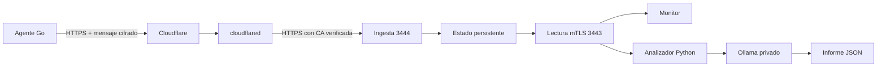

# service-status-api

API de estado con telemetría cifrada, Cloudflare Tunnel, lectura privada por mTLS y análisis con IA local.

Implementación independiente del esquema utilizado en mis servicios: emisor remoto, recepción por túnel, persistencia y consultas internas autenticadas. Los canales son servicios independientes, por ejemplo `web` y `juego`; cada canal tiene su propia clave.

| Componente | Tecnología | Función |
| --- | --- | --- |
| API | TypeScript · Node.js 24 | Recibir lecturas, comprobar mensajes y consultar estados |
| Agente | Go | Comprobar una URL y enviar disponibilidad y latencia |
| Análisis | Python · Ollama · Qwen 3.5 | Generar informes a partir de las lecturas |
| Entrada | Cloudflare Tunnel | Conectar con la ingesta HTTPS sin abrir puertos del host |
| Despliegue | Docker Compose · Portainer | Separar servicios, redes, secretos y persistencia |



## Estado de los canales

| Valor | Significado |
| --- | --- |
| `sin_datos` | El canal todavía no recibió lecturas |
| `online` | La última comprobación fue positiva y sigue vigente |
| `offline` | La última comprobación falló y sigue vigente |
| `sin_senal` | La lectura tiene más de 90 segundos o su fecha no es válida |

Una lectura vencida devuelve `online`, `latencia_ms`, `usuarios` y `capacidad` en `null`. La salud de la API es independiente del estado de los canales.

El agente considera disponibles las respuestas HTTP 200–399. No sigue redirecciones. Un 302 a un login es una respuesta válida del servicio, no un fallo. La comprobación HTTP no acredita que todos los procesos internos funcionen.

## Ejecutar sin Docker

Requisitos: Node.js 24.12 o posterior, Go 1.26 o posterior, Python 3.12 o posterior y OpenSSL. La API y el analizador no necesitan paquetes externos en ejecución.

```sh
git clone https://github.com/em4nu3i69dll/service-status-api.git
cd service-status-api
python operacion/preparar.py
npm start
```

`preparar.py` genera una CA local, certificados de servidor y clientes, y claves independientes para `web` y `juego`. No sobrescribe directorios existentes. Los certificados cliente y servidor duran 90 días; la CA dura un año. Para otros canales: `python operacion/preparar.py --canales web juego panel`.

En Windows, si OpenSSL no está en PATH, definí `OPENSSL` con la ruta de `openssl.exe`. En Linux, usá `python3` si tu instalación no tiene el comando `python`.

Desde otra terminal, compilá el agente:

```sh
cd agente
go build -o ../local/agente .
cd ..
./local/agente -objetivo https://example.com -api https://localhost:3444 -ca local/secretos/ca.crt -clave local/secretos/web.key -canal web
```

En Windows: `go build -o ../local/agente.exe .` y `./local/agente.exe`. Añadí `-intervalo 30s` para comprobar el servicio periódicamente. El mínimo es 5 segundos. `-usuarios` y `-capacidad` son opcionales; el agente no inventa estos datos ni los descubre con una petición HTTP.

Consultá la lectura privada:

```sh
curl --cacert local/secretos/ca.crt --cert local/secretos/monitor.crt --key local/secretos/monitor.key https://localhost:3443/api/v1/estado
```

## API

| Método | Puerto | Ruta | Acceso |
| --- | --- | --- | --- |
| POST | 3444 | `/api/v1/estado` | Sobre cifrado y clave del canal |
| GET | 3443 | `/api/salud` | Certificado cliente autorizado |
| GET | 3443 | `/api/v1/estado` | Certificado `monitor` o `ia` |
| GET | 3443 | `/api/v1/estado/web` | Certificado `monitor` o `ia` |
| GET | 3443 | `/api/v1/historial/web` | Certificado `monitor` o `ia` |

```json
{
  "canal": "web",
  "estado": "online",
  "online": true,
  "latencia_ms": 24,
  "usuarios": null,
  "capacidad": null,
  "ultima_lectura": "2026-10-28T12:00:00.000Z",
  "antiguedad_segundos": 2,
  "muestras": 1
}
```

La ingesta no acepta el JSON de ejemplo directamente. El agente cifra el mensaje y comprueba la confirmación. El canal `juego` usa su archivo `juego.key`. Las rutas del puerto 3443 no se publican por Cloudflare.

## Docker Compose

Prepará `local/` antes de iniciar los contenedores. En Linux, los procesos usan UID/GID 1000 y necesitan leer sus secretos y escribir en datos e informes:

```sh
sudo chown -R 1000:1000 local
docker compose up -d --build api
docker compose ps
```

El Compose no publica puertos del host. La API está en una red interna; únicamente el túnel, el agente y la descarga de modelos tienen una red de salida. El sistema de archivos de API, agente, analizador y túnel es de solo lectura. Se limitan CPU, memoria, procesos y tamaño de logs.

Ejecutar el agente dentro de Compose:

```sh
docker compose build agente
docker compose run --rm agente -api https://api:3444 -nombre-tls status-api -ca /run/secrets/ca.crt -clave /run/secrets/web.key -canal web -objetivo https://example.com
```

## Cloudflare Tunnel

Creá un túnel administrado localmente desde una máquina con `cloudflared` autenticado:

```sh
cloudflared tunnel create service-status
cloudflared tunnel route dns service-status estado.example.com
```

Copiá el JSON de credenciales del túnel a `local/secretos/tunel.json`. No copies el certificado administrativo `cert.pem`. Generá la ruta con el UUID que devuelve Cloudflare:

```sh
python operacion/configurar_tunel.py --id TU-UUID --dominio estado.example.com
docker compose --profile cloudflare up -d tunel
```

La configuración admite exclusivamente `/api/v1/estado` en ese hostname y devuelve 404 en el resto. `cloudflared` verifica el certificado del origen con `caPool` y `originServerName`; `noTLSVerify` permanece en `false`. Las credenciales del túnel no autorizan la ingesta: cada emisor necesita además la clave de su canal.

Para enviar desde otra máquina, usá `-api https://estado.example.com`, la clave del canal y la CA pública del sistema. No pases `-ca` ni `-nombre-tls` para el dominio de Cloudflare. Solo se distribuye al emisor la clave de su canal, nunca `canales.json`, la clave de la CA ni certificados de lectura.

Configuración de referencia: [parámetros del origen](https://developers.cloudflare.com/tunnel/reference/origin-parameters/) y [túneles administrados localmente](https://developers.cloudflare.com/cloudflare-one/networks/connectors/cloudflare-tunnel/do-more-with-tunnels/local-management/create-local-tunnel/).

## IA local

El analizador consulta la API con su certificado, envía únicamente lecturas vigentes a Ollama y valida una respuesta JSON con resumen y observaciones por canal. Los canales sin datos o con señal vencida se registran aparte sin pedir al modelo que deduzca disponibilidad. Si no hay lecturas vigentes, no se llama al modelo. No ejecuta comandos ni cambia estados. Si el modelo falla o corta la respuesta, conserva el informe anterior; cada informe incluye su fecha y evidencia.

```sh
docker compose --profile ia up -d ollama
docker compose exec ollama ollama pull qwen3.5:0.8b
docker compose build ia
docker compose run --rm ia
```

Salida: `local/informes/ultimo.json`. Para ejecución periódica, añadí `--intervalo 300` al comando del analizador. Su cliente usa Python estándar y se puede ejecutar fuera de Docker con `python ia/analizar.py`.

El modelo inicial es Qwen 3.5 0.8B para limitar consumo. Se puede cambiar con `--modelo`, descargando antes esa variante en Ollama y ajustando los límites de memoria del servicio. La prioridad la fija el código a partir de la lectura: `alta` para offline y `baja` para online; no se toma la prioridad propuesta por el modelo. La salida de IA requiere revisión: un esquema JSON válido no garantiza una conclusión correcta.

Referencias: [Qwen 3.5](https://ollama.com/library/qwen3.5) y [API de Ollama](https://docs.ollama.com/api/chat).

## Portainer

Usá el mismo `compose.yaml` como stack desde Git. Prepará certificados y datos en el host Docker y definí `STATUS_LOCAL` con su ruta absoluta antes del despliegue. Los perfiles `cloudflare`, `agente` e `ia` son opcionales. Si Portainer no permite seleccionar perfiles, ejecutá esos servicios con Compose en el host. No pegues claves ni credenciales del túnel en el editor del stack.

## Protocolo y persistencia

AES-256-GCM cifra la lectura y el acuse. HKDF-SHA256 separa las claves de cifrado y firma por canal. HMAC-SHA256 vincula versión, dirección, ruta, canal, fecha, nonce y cuerpo. El acuse identifica el nonce y la secuencia de la solicitud.

Se rechazan fechas con más de 90 segundos de antigüedad o más de 15 segundos hacia el futuro. Nonces y secuencias se guardan junto al estado para conservar la protección contra repetición tras reiniciar. Cada instancia del agente tiene un identificador aleatorio. El orden de sus secuencias se conserva durante 24 horas; los mensajes también deben superar los controles de fecha y nonce.

Máximo: 32 canales, 60 lecturas por canal, cuerpo de 4 KiB y límites globales de solicitudes. La persistencia usa un archivo temporal, sincronización a disco y reemplazo por renombrado. Solo debe ejecutarse una instancia de la API por archivo de estado; no es un almacenamiento distribuido.

`local/` queda fuera de Git y de las imágenes. Resguardá la clave de la CA fuera del host una vez emitidos los certificados. Para rotar un canal, reemplazá su clave y reiniciá la API y sus emisores. La autorización de lectura valida CA, uso de certificado y nombre de cliente; no implementa CRL/OCSP.

## Pruebas

```sh
npm ci --ignore-scripts
npm run typecheck
npm test
cd agente
go vet ./...
cd ..
python -m unittest discover -s pruebas -p 'test_*.py' -v
```

Las pruebas usan certificados temporales, servidores reales HTTPS/mTLS y el agente Go compilado. Comprueban ingesta, firma, separación de canales, replay concurrente, reinicio, vencimiento, permisos y respuestas incompletas de IA. Los servicios de prueba no usan credenciales de infraestructura.

## Autor

Emanuel Duarte · [em4nu3i69dll](https://github.com/em4nu3i69dll)
